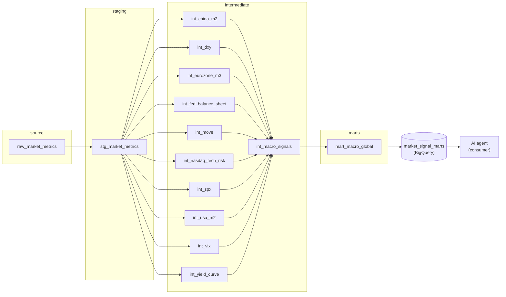

# Market Signal Stack

[](https://www.getdbt.com/)
[](https://cloud.google.com/bigquery)
[](LICENSE)

A dbt pipeline over BigQuery that turns raw macro, crypto, and on-chain market data into normalized signals feeding an AI agent that evaluates Bitcoin's market cycle.

## Contents
- [Architecture](#architecture)
- [Current status](#current-status)
- [Indicators in progress](#indicators-in-progress)
- [Roadmap](#roadmap)
- [Running it](#running-it)
- [Tests and quality guarantees](#tests-and-quality-guarantees)

## Architecture



- **`raw_market_signals`**: the BigQuery dataset where raw data is loaded. dbt doesn't build it, it only reads it as a `source`.
- **`models/staging/`**: minimal cleanup (type casting, column selection) on top of the raw data. No business logic. Materialized as `ephemeral` — it never lands as its own table, it's inlined into the models that use it.
- **`models/intermediate/`**: where the business logic lives, as views. One `int_<indicator>` per indicator holds its formula and its signal (`BULLISH` / `NEUTRAL` / `BEARISH`) following the rules in `docs/indicator_rules/`, and one `int_<layer>_signals` per layer stacks that layer's indicators by date. These are internal building blocks: the agent doesn't read them.
- **`models/marts/`**: one mart per signal layer, materialized as a table in `market_signal_marts` — the dataset consumed by the agent through a read-only service account. Each layer mart has one row per day and one `signal_<indicator>` column per indicator, with an enforced data contract. There is no mart per indicator.

## Current status

One layer built — **Macro Global** — exposed to the agent as `mart_macro_global`, on top of ten indicators:

- **Yield Curve (10Y-2Y)** (`int_yield_curve`): spread between the 10-year and 2-year US Treasury yields, a recession-risk and risk-appetite signal. Computes the daily spread, a categorical signal (`BULLISH` / `NEUTRAL` / `BEARISH`) with a normalized value, and applies forward-fill when one of the two series is missing for a given day — each row explicitly flags whether its value is real or carried forward (`is_dgs2_imputed`, `is_dgs10_imputed`).
- **FED Balance Sheet (QE/QT)** (`int_fed_balance_sheet`): weekly change in the Federal Reserve's balance sheet (WALCL), a liquidity expansion/contraction signal. Computes the week-over-week delta and the same normalized categorical signal.
- **DXY (US Dollar Index)** (`int_dxy`): distance of the US Dollar Index from its 50-day moving average, a global liquidity pressure signal.
- **VIX (Volatility Index)** (`int_vix`): z-score (capped at ±3) of the VIX's 20-day moving average against its 750-day history, a risk-aversion signal.
- **S&P 500 Risk Regime** (`int_spx`): distance of the S&P 500 from its 200-day moving average, a structural risk-appetite signal.
- **NASDAQ 100 Tech Risk Regime** (`int_nasdaq_tech_risk`): distance of the NASDAQ 100 (^NDX) from its 200-day moving average, a technology-led risk-appetite signal. Same pattern as SPX, and it also exposes the daily change plus the `btc_bias` and `message` for each threshold from its rules file.
- **MOVE Index** (`int_move`): z-score (capped at ±3) of the MOVE Index's 30-day moving average against its 1000-day history, a bond-market volatility and systemic-stress signal.
- **Eurozone M3 Money Supply** (`int_eurozone_m3`): year-over-year growth of euro area M3 (ECB, monthly), ranked as a percentile against its own last 180 months (~15 years), a regional liquidity signal. M3 is used as a proxy for M2, which isn't ingested yet — since the signal is a percentile of the series against its own history, the thresholds work the same on M3's distribution.
- **US M2 Money Supply** (`int_usa_m2`): year-over-year growth of US M2 (FRED `M2SL`, monthly), ranked as a percentile against its own last 240 months (~20 years), a domestic and global liquidity signal.
- **China M2 Money Supply** (`int_china_m2`): year-over-year growth of China's M2 (TradingEconomics, monthly), ranked as a percentile against its own last 120 months (~10 years), a global liquidity expansion/contraction signal.

Each indicator follows the same pattern: generic staging, an `int_<indicator>` with the business logic, rules documented in `docs/indicator_rules/`, and tests. `int_macro_signals` stacks the ten by date with no recalculation.

**`mart_macro_global`** has one row per calendar day (7 days a week, since BTC trades every day), from the first day any indicator has a signal (1979-12-01) to the latest observation. For each indicator it exposes `signal_<indicator>` and `<indicator>_as_of`:

- **Carry-forward with expiry.** Each day takes the indicator's latest observation, so weekly and monthly indicators — and daily ones over weekends and holidays — still have a value. `<indicator>_as_of` is the date of the observation used, so carried values are always visible. An observation older than its cadence's source-freshness `error_after` (3 days daily, 14 weekly, 60 monthly — read from `_sources.yml`) expires and both columns go `NULL`.
- **Look-ahead caveat.** Monthly indicators are dated by the month they describe, not by when they're published (euro area M3 for August comes out at the end of September), so a row can carry a figure that wasn't public yet on that day. It doesn't matter for the agent's daily reading; it does for a backtest.
- **No combined layer signal yet.** How the ten signals combine into one `layer_signal` is still to be defined, so the mart exposes the individual signals only.

## Indicators in progress

All ten indicators have a signal today, but over very different spans of history:

| Indicator | History loaded | Signal from |
|---|---|---|
| US M2 | 1959-01 | 1979-12 |
| Eurozone M3 | 1980-01 | 1995-12 |
| China M2 | 2008-01 | 2018-12 |
| VIX | 2010-01 | 2013-01 |
| MOVE | 2020-01 | 2024-02 |
| Yield Curve | 2025-09 | 2025-09 |
| FED Balance Sheet | 2025-10 | 2025-10 |
| DXY | 2025-09 | 2025-12 |
| S&P 500 | 2025-09 | 2026-07 |
| NASDAQ 100 | 2025-09 | 2026-07 |

The gap between "history loaded" and "signal from" is each formula's window: until it's complete, the indicator intentionally returns `NULL` for `signal`/`normalized_value` — **this is not a bug**. A guardrail (`COUNT() OVER` the same window) prevents computing an average, z-score or percentile from fewer observations than the formula requires, instead of silently returning a partial result dressed up as a complete one.

The five indicators at the bottom of the table only have about a year of history because their backfill hasn't been loaded yet, even though the ingestion config already declares one (yields from 1962/1976, FED balance sheet from 2002, DXY, S&P 500 and NASDAQ 100 from 2010). Until it is, `mart_macro_global` has only the macro liquidity and volatility indicators before late 2025, and those five columns are `NULL`. Loading those backfills fixes it with no code changes.

## Roadmap

Macro Global is the first of several signal layers meant to feed BTC market-cycle evaluation, each with the same shape: `int_<indicator>` models, an `int_<layer>_signals`, and one `mart_<layer>` for the agent. Next are **Crypto Liquidity** (`mart_crypto_liquidity`, starting with daily BTC spot ETF flows) and **On-chain BTC** (`mart_onchain_btc`). Once at least two layers are ready, a final `mart_btc_cycle_signal` will combine them.

## Running it

Requires Python 3.11+, [uv](https://docs.astral.sh/uv/), and access to the GCP project this pipeline targets.

```bash
uv sync                # install dependencies
uv run dbt deps        # install dbt packages (dbt_utils)
uv run dbt debug        # verify the BigQuery connection
uv run dbt run          # build the models
uv run dbt test         # run the tests
```

`profiles.yml` is not in this repo — it lives at `~/.dbt/profiles.yml` on each machine, with the BigQuery credentials (including the real GCP project ID). It needs to be created separately before running anything; `dbt debug` confirms whether it's set up correctly.

## Tests and quality guarantees

This pipeline isn't a loose script: every layer has its own automated checks.

- **Source freshness**: one check per load cadence — daily metrics warn after 1 day without new rows and fail after 3, weekly after 10/14 days, monthly after 40/60 days.
- **Per-metric freshness**: dbt's source freshness only looks at the most recent row across a whole cadence group, so one metric can stop loading unnoticed while the others in its group keep it looking fresh. A dedicated test (`assert_per_metric_freshness`) applies the same thresholds metric by metric and fails naming each metric that went stale. It reads those thresholds from the source freshness config, so both checks always stay aligned. For now it runs at `warn` severity: a single stale metric shows up in the log without stopping the daily build, so the other indicators keep refreshing. It will be raised to `error` once the ingestion pipeline is more mature.
- **Data integrity**: key columns are never null, and the metric + date combination is unique (no duplicates).
- **Data contracts**: every mart enforces its schema (column names and BigQuery types) at build time — if the SQL output drifts from the declared schema, the build fails instead of silently changing the table the agent reads. Read access for the agent's service account is granted per table by dbt itself.
- **Forward-fill guardrail**: a dedicated test fails if an indicator has been carrying forward the same value for more than 5 days in a row — a sign the source pipeline stopped delivering data and no one noticed.

For finer technical detail — code conventions, exact commands, known gotchas — see [CLAUDE.md](CLAUDE.md).
