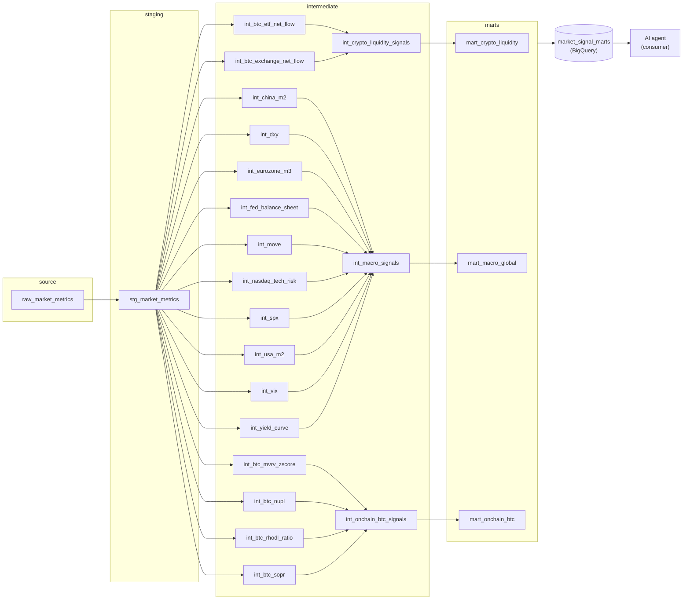

# Market Signal Stack

[](https://www.getdbt.com/)
[](https://cloud.google.com/bigquery)
[](LICENSE)

A dbt pipeline over BigQuery that turns raw macro, crypto, and on-chain market data into normalized signals feeding an AI agent that evaluates Bitcoin's market cycle.

## Contents
- [Architecture](#architecture)
- [Current status](#current-status)
- [Indicators in progress](#indicators-in-progress)
- [Roadmap](#roadmap)
- [Running it](#running-it)
- [Tests and quality guarantees](#tests-and-quality-guarantees)

## Architecture



- **`raw_market_signals`**: the BigQuery dataset where raw data is loaded. dbt doesn't build it, it only reads it as a `source`.
- **`models/staging/`**: minimal cleanup (type casting, column selection) on top of the raw data. No business logic. Materialized as `ephemeral` — it never lands as its own table, it's inlined into the models that use it.
- **`models/intermediate/`**: where the business logic lives, as views. One `int_<indicator>` per indicator holds its formula and its signal (`BULLISH` / `NEUTRAL` / `BEARISH`) following the rules in `docs/indicator_rules/`, and one `int_<layer>_signals` per layer stacks that layer's indicators by date. These are internal building blocks: the agent doesn't read them.
- **`models/marts/`**: one mart per signal layer, materialized as a table in `market_signal_marts` — the dataset consumed by the agent through a read-only service account. Each layer mart has one row per day, one `signal_<indicator>` column per indicator and a combined `layer_signal`, with an enforced data contract. There is no mart per indicator.

## Current status

Three layers built, each exposed to the agent as one mart: **Macro Global** (`mart_macro_global`, ten indicators), **Crypto Liquidity** (`mart_crypto_liquidity`, two indicators) and **On-chain BTC** (`mart_onchain_btc`, four indicators).

### Macro Global

- **Yield Curve (10Y-2Y)** (`int_yield_curve`): spread between the 10-year and 2-year US Treasury yields, a recession-risk and risk-appetite signal. Computes the daily spread, a categorical signal (`BULLISH` / `NEUTRAL` / `BEARISH`) with a normalized value, and applies forward-fill when one of the two series is missing for a given day — each row explicitly flags whether its value is real or carried forward (`is_dgs2_imputed`, `is_dgs10_imputed`).
- **FED Balance Sheet (QE/QT)** (`int_fed_balance_sheet`): weekly change in the Federal Reserve's balance sheet (WALCL), a liquidity expansion/contraction signal. Computes the week-over-week delta and the same normalized categorical signal.
- **DXY (US Dollar Index)** (`int_dxy`): distance of the US Dollar Index from its 50-day moving average, a global liquidity pressure signal.
- **VIX (Volatility Index)** (`int_vix`): z-score (capped at ±3) of the VIX's 20-day moving average against its 750-day history, a risk-aversion signal.
- **S&P 500 Risk Regime** (`int_spx`): distance of the S&P 500 from its 200-day moving average, a structural risk-appetite signal.
- **NASDAQ 100 Tech Risk Regime** (`int_nasdaq_tech_risk`): distance of the NASDAQ 100 (^NDX) from its 200-day moving average, a technology-led risk-appetite signal. Same pattern as SPX, and it also exposes the daily change plus the `btc_bias` and `message` for each threshold from its rules file.
- **MOVE Index** (`int_move`): z-score (capped at ±3) of the MOVE Index's 30-day moving average against its 1000-day history, a bond-market volatility and systemic-stress signal.
- **Eurozone M3 Money Supply** (`int_eurozone_m3`): year-over-year growth of euro area M3 (ECB, monthly), ranked as a percentile against its own last 180 months (~15 years), a regional liquidity signal. M3 is used as a proxy for M2, which isn't ingested yet — since the signal is a percentile of the series against its own history, the thresholds work the same on M3's distribution.
- **US M2 Money Supply** (`int_usa_m2`): year-over-year growth of US M2 (FRED `M2SL`, monthly), ranked as a percentile against its own last 240 months (~20 years), a domestic and global liquidity signal.
- **China M2 Money Supply** (`int_china_m2`): year-over-year growth of China's M2 (TradingEconomics, monthly), ranked as a percentile against its own last 120 months (~10 years), a global liquidity expansion/contraction signal.

Each indicator follows the same pattern: generic staging, an `int_<indicator>` with the business logic, rules documented in `docs/indicator_rules/`, and tests. `int_macro_signals` stacks the ten by date with no recalculation.

**`mart_macro_global`** has one row per calendar day (7 days a week, since BTC trades every day), from the first day any indicator has a signal (1979-12-01) to the latest observation. For each indicator it exposes `signal_<indicator>` and `<indicator>_as_of`:

- **Carry-forward with expiry.** Each day takes the indicator's latest observation, so weekly and monthly indicators — and daily ones over weekends and holidays — still have a value. `<indicator>_as_of` is the date of the observation used, so carried values are always visible. An observation older than its cadence's source-freshness `error_after` (3 days daily, 14 weekly, 60 monthly — read from `_sources.yml`) expires and both columns go `NULL`.
- **Look-ahead caveat.** Monthly indicators are dated by the month they describe, not by when they're published (euro area M3 for August comes out at the end of September), so a row can carry a figure that wasn't public yet on that day. It doesn't matter for the agent's daily reading; it does for a backtest.
- **Combined layer signal.** `layer_signal` weighs the ten into one reading — see [Layer signal](#layer-signal). It's `NULL` before 2025-10-08, while five indicators are still waiting for their backfill.

### Crypto Liquidity

- **BTC Spot ETF Net Flow** (`int_btc_etf_net_flow`): daily net flow into all US spot bitcoin ETFs (Farside total, US$ millions), a proxy for institutional demand. `BULLISH` from +$200M a day, `BEARISH` below −$100M, and on days in between, a streak of 5 sessions in a row of inflows (or outflows) gives a weaker `BULLISH` (or `BEARISH`). One row per US trading session: the holidays Farside publishes as 0 are dropped, since they mean "market closed", not "flat flows". The per-ETF breakdown (IBIT, FBTC, GBTC…) is kept in the raw payload but not used yet.
- **BTC Exchange Net Flow** (`int_btc_exchange_net_flow`): BTC leaving exchanges minus BTC arriving (Coin Metrics, in BTC). Positive means coins are being withdrawn — accumulation, `BULLISH`; negative means coins are being deposited to sell — `BEARISH`. Fixed thresholds at ±2,000 and ±5,000 BTC, and three days in a row beyond ±2,000 strengthen the signal. If either series is missing for a day, the signal is `NULL` rather than filled in.

Each indicator follows the same pattern as in Macro Global, and `int_crypto_liquidity_signals` stacks the two by date.

**`mart_crypto_liquidity`** has the same shape as `mart_macro_global`: one row per calendar day from 2011-04-24 (the first exchange-flow day), `signal_<indicator>` and `<indicator>_as_of`, and the same carry-forward with expiry (3 days, since both are daily). ETF flows only exist on US trading days, so weekends and holidays carry the last session's signal; before the first ETF session (2024-01-11) that column is `NULL`. Its `layer_signal` follows the same rule as Macro Global's and needs both indicators, so it starts on 2024-01-11.

Two limits worth knowing:

- **Exchange flows aren't comparable before ~2020.** How much volume Coin Metrics attributes to exchanges depends on which exchanges it tracks, and that has changed a lot (average daily inflow ~1.7k BTC in 2011, ~66k in 2015–2017, ~21k in 2026). With fixed thresholds, older years land in the extreme bands far more often.
- **Recent exchange flows get revised.** Coin Metrics publishes them as preliminary and corrects them for about 30 days, so the signal for the last month can change between runs.

### On-chain BTC

Four Bitcoin cycle indicators. Rules in `docs/indicator_rules/`, design and decisions in `docs/specs/` (one spec per indicator plus `onchain_btc_layer.md`), independent QA in `docs/qa/onchain_layer_qa.md`.

| Indicator | Model | Source | Weight | Signal from |
|---|---|---|---|---|
| **NUPL** (Net Unrealized Profit/Loss) | `int_btc_nupl` | Coin Metrics: `1 − 1 / MVRV` | 0.9 | 2012-01-01 |
| **MVRV Z-Score** | `int_btc_mvrv_zscore` | Coin Metrics: `(market cap − realized cap) / std(market cap)` | 1.1 (to confirm) | 2012-01-01 |
| **SOPR** (Spent Output Profit Ratio) | `int_btc_sopr` | BGeometrics, precomputed | 0.7 | 2022-11-26 |
| **RHODL Ratio** | `int_btc_rhodl_ratio` | BGeometrics, precomputed | 1.1 | 2022-11-26 |

- **NUPL** is derived from Coin Metrics' MVRV (an exact identity), not loaded from Glassnode as the original rule said. `NULL` before 2012-01-01: earlier, almost every coin had been mined at no cost before there was a market, so it isn't a market reading.
- **MVRV Z-Score** uses the standard definition: the sample standard deviation of market cap over an expanding window from the first available data point (2010-07-18), with no look-ahead. Its cycle maxima and minima match Look Into Bitcoin's (tops 10.65 / 10.08 / 7.15 against 10.53 / 10.04 / 7.13). The 4–7 band is an assumption.
- **SOPR** is the raw daily value. BGeometrics' free plan publishes it with a ~7-day lag, so it gets a 10-day expiry instead of 3, and the lowest weight. Which SOPR variant it is (plain, adjusted or short-term holder) is still to be confirmed.
- **RHODL Ratio** has **provisional** bands: the outer ones come from Look Into Bitcoin's chart zones (−1.0 from 22,000, +1.0 below 350), the middle ones are assumptions. Cycle tops fall each cycle, so the 2021 and 2024 tops land at −0.6, not −1.0. Valid at cycle scale only: providers differ by ~5–10 %.
- **Realized Price** was evaluated and left out (parked): with the same input, its distance from spot is exactly MVRV − 1.

**`mart_onchain_btc`** has the same shape as the other layer marts, plus one `<indicator>_data_age_days` column per indicator: the days between the row's date and the indicator's latest observation, published even when it has expired, so the agent can weigh how stale each signal is. It's relative to the mart's date, not to today (staleness versus today is source freshness). Expiry is 3 days for NUPL, MVRV-Z and RHODL and 10 for SOPR.

Two limits worth knowing:

- **The MVRV family.** NUPL and MVRV-Z are both functions of MVRV, about 53 % of the layer's weight. Accepted for now; to be reviewed once the agent uses the signal.
- **Only four years of BGeometrics history.** SOPR and RHODL start on 2022-11-26 (free-API window), which is why the layer has no signal before then.

### Layer signal

Each layer mart also combines its indicators into a single reading for the day, with the same rule in every layer (`docs/layer_rules/`):

- **`layer_score`**: the weighted average of the `normalized_value` (−1 to +1) of the indicators that have a signal that day, carried-forward ones included. Each indicator's weight comes from its rule in `docs/indicator_rules/` — for example 1.3 for the yield curve or the FED balance sheet, 0.9 for VIX. Indicators without a signal that day count neither in the sum nor in the weights.
- **`layer_coverage`**: the share of the layer's total weight that has a signal that day, from 0 to 1.
- **`layer_signal`**: `BULLISH` when `layer_score` is 0.3 or more, `BEARISH` below −0.3, and `NEUTRAL` in between.

A reading built on a few indicators would look as confident as one built on all of them, so **below 70% coverage there's no layer signal**: `layer_score` and `layer_signal` are `NULL`, while `layer_coverage` is still published so you can see how far off it is. The calculation uses exact decimal arithmetic, because the cutoffs land exactly on real values — Macro Global's first signal day has coverage of exactly 70%.

What that means today:

- **Macro Global has no layer signal before 2025-10-08.** The five indicators whose backfill is still pending (yield curve, FED balance sheet, DXY, S&P 500 and NASDAQ 100) carry more than half of the layer's weight, so before they have data the coverage can't reach 70%. Loading those backfills would extend the layer signal back years, with no code changes.
- **Crypto Liquidity needs both of its indicators** — neither reaches 70% of the weight alone — so it has no layer signal before the first ETF session (2024-01-11), or on any day one of the two is missing or expired.
- **On-chain BTC has no layer signal before 2022-11-26.** Before the BGeometrics series start, only NUPL and MVRV-Z exist (2.0 of 3.8, 53%). From then on it survives one missing indicator (coverage ≥ 71%), not two.

## Indicators in progress

All sixteen indicators have a signal today, but over very different spans of history:

| Indicator | History loaded | Signal from |
|---|---|---|
| US M2 | 1959-01 | 1979-12 |
| Eurozone M3 | 1980-01 | 1995-12 |
| China M2 | 2008-01 | 2018-12 |
| VIX | 2010-01 | 2013-01 |
| NUPL | 2010-07 | 2012-01 |
| MVRV Z-Score | 2010-07 | 2012-01 |
| BTC Exchange Net Flow | 2011-04 | 2011-04 |
| MOVE | 2020-01 | 2024-02 |
| SOPR | 2022-11 | 2022-11 |
| RHODL Ratio | 2022-11 | 2022-11 |
| BTC Spot ETF Net Flow | 2024-01 | 2024-01 |
| Yield Curve | 2025-09 | 2025-09 |
| FED Balance Sheet | 2025-10 | 2025-10 |
| DXY | 2025-09 | 2025-12 |
| S&P 500 | 2025-09 | 2026-07 |
| NASDAQ 100 | 2025-09 | 2026-07 |

The gap between "history loaded" and "signal from" is each formula's window: until it's complete, the indicator intentionally returns `NULL` for `signal`/`normalized_value` — **this is not a bug**. A guardrail (`COUNT() OVER` the same window) prevents computing an average, z-score or percentile from fewer observations than the formula requires, instead of silently returning a partial result dressed up as a complete one.

The five indicators at the bottom of the table only have about a year of history because their backfill hasn't been loaded yet, even though the ingestion config already declares one (yields from 1962/1976, FED balance sheet from 2002, DXY, S&P 500 and NASDAQ 100 from 2010). Until it is, `mart_macro_global` has only the macro liquidity and volatility indicators before late 2025, and those five columns are `NULL`. Loading those backfills fixes it with no code changes.

## Roadmap

Macro Global, Crypto Liquidity and On-chain BTC are the first signal layers meant to feed BTC market-cycle evaluation, each with the same shape: `int_<indicator>` models, an `int_<layer>_signals`, and one `mart_<layer>` for the agent. A final `mart_btc_cycle_signal` will combine their `layer_signal`. For Crypto Liquidity, the per-ETF rules (IBIT/FBTC leading inflows, GBTC outflows) are a planned improvement.

### Pending next week

- **Human QA by Sergi** of the on-chain layer (week of 2026-11-30). The independent QA by Claude Code is done (`docs/qa/onchain_layer_qa.md`).
- **Guardrails / tests:** a unit test for the stale-indicator case in `mart_onchain_btc` (it has never happened in real data); a unit test for RHODL ≥ 22,000 (the −1.0 band has never fired in real data); boundary tests for the MVRV-Z limits 2, 4 and 7; any further tests from the human QA.
- **Cross-check** our Coin Metrics-derived NUPL and MVRV-Z against the BGeometrics series Sara loaded on 2026-11-26.
- **Open questions for Sara:** the SOPR variant (plain, adjusted or short-term holder); a free source for more than 4 years of SOPR / RHODL history; P4, adding `btc_mvrv` and `btc_market_cap` to the daily freshness filter; P9, the `btc_price` backfill.

## Running it

Requires Python 3.11+, [uv](https://docs.astral.sh/uv/), and access to the GCP project this pipeline targets.

```bash
uv sync                # install dependencies
uv run dbt deps        # install dbt packages (dbt_utils)
uv run dbt debug        # verify the BigQuery connection
uv run dbt run          # build the models
uv run dbt test         # run the tests
```

`profiles.yml` is not in this repo — it lives at `~/.dbt/profiles.yml` on each machine, with the BigQuery credentials (including the real GCP project ID). It needs to be created separately before running anything; `dbt debug` confirms whether it's set up correctly.

## Tests and quality guarantees

This pipeline isn't a loose script: every layer has its own automated checks.

- **Source freshness**: one check per load cadence — daily metrics warn after 1 day without new rows and fail after 3, weekly after 10/14 days, monthly after 40/60 days — plus one for the BGeometrics on-chain series (8/10 days, because of the free plan's lag).
- **Per-metric freshness**: dbt's source freshness only looks at the most recent row across a whole cadence group, so one metric can stop loading unnoticed while the others in its group keep it looking fresh. A dedicated test (`assert_per_metric_freshness`) applies the same thresholds metric by metric and fails naming each metric that went stale. It reads those thresholds from the source freshness config, so both checks always stay aligned. For now it runs at `warn` severity: a single stale metric shows up in the log without stopping the daily build, so the other indicators keep refreshing. It will be raised to `error` once the ingestion pipeline is more mature.
- **Data integrity**: key columns are never null, and the metric + date combination is unique (no duplicates).
- **Data contracts**: every mart enforces its schema (column names and BigQuery types) at build time — if the SQL output drifts from the declared schema, the build fails instead of silently changing the table the agent reads. Read access for the agent's service account is granted per table by dbt itself (`macros/sara_marts_reader.sql`); builds into the refactor dataset always grant to a placeholder, so unvalidated tables are never shared.
- **Unit and reference tests**: band edges are pinned by dbt unit tests, and on-chain indicators have historical reference points (cycle tops and bottoms) checked at `warn` severity.
- **Forward-fill guardrail**: a dedicated test fails if an indicator has been carrying forward the same value for more than 5 days in a row — a sign the source pipeline stopped delivering data and no one noticed.

For finer technical detail — code conventions, exact commands, known gotchas — see [CLAUDE.md](CLAUDE.md).
